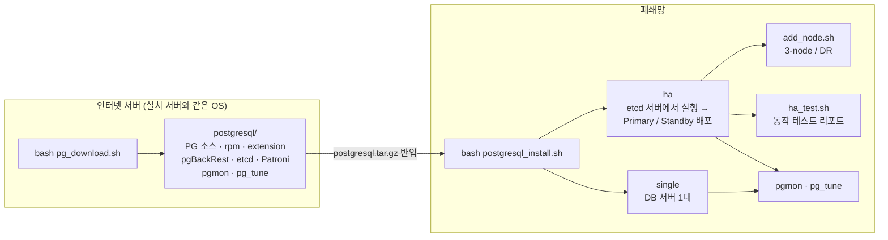
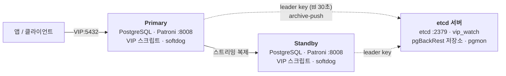

# pg_project — 폐쇄망 PostgreSQL 설치 · HA · 백업 · 모니터링 · 튜닝

인터넷이 되는 서버에서 설치에 필요한 모든 것(소스, 의존 rpm, extension, HA 패키지, 모니터링/튜닝 툴)을
`postgresql/` 한 디렉토리로 모으고, 폐쇄망 서버로 옮겨서
**소스 빌드 → initdb → 튜닝 → 백업 → (HA) Patroni 구성**까지 스크립트 한 번으로 설치합니다.

| | |
|---|---|
| 대상 OS | RHEL 계열 8/9 (Rocky, Alma), x86_64 |
| 설치 모드 | `single` (1대) / `ha` (etcd 서버 + Primary + Standby, Patroni) |
| 백업 | `basebackup` (pg_basebackup + 아카이브) / `pgbackrest` (HA 는 etcd 서버가 저장소) |
| 운영 도구 | **pgmon** (터미널 모니터링 + 알림) · **pg_tune** (규칙 기반 쿼리 튜너) |
| 문서 | [`docs/`](docs) — 아키텍처(그림) · 설치 · 운영 · pgmon 가이드 (txt + pdf) |

---

## 한눈에 보기



### HA 구성



- Primary 가 죽으면 ttl(30초) 후 Standby 가 승격하고 VIP 가 따라옵니다 (약 30~40초).
- split-brain / 유실 방지: **watchdog**(멈춘 노드 리부트) · **failsafe_mode**(etcd 전체 장애에도 Primary 유지) · **synchronous_mode**(선택, 유실 0).
- 3-node etcd 를 고르면 DB 노드에도 etcd 가 올라가 etcd 서버 1대 장애에 영향이 없습니다.

그림으로 자세히: **[docs/아키텍처_가이드.pdf](docs/아키텍처_가이드.pdf)** (전체 흐름, HA 설치 단계, failover 시퀀스, 장애 유형별 동작, VIP 3중 관리, 백업 비교, pgmon / pg_tune 구조, 포트 · 디렉토리)

---

## 빠른 시작

### 1) 패키지 받기 — 인터넷 서버

```bash
git clone https://github.com/naturalTuna/pg_project.git && cd pg_project
bash pg_download.sh                          # PG 버전 / single·ha / pgmon 여부 질문
bash pg_download.sh --verify                 # (선택) 이 서버에서 시험 빌드까지
bash pg_download.sh --lock BUILD_LOCK.txt    # (선택) 예전과 같은 구성으로 다시 받기
tar -czf postgresql.tar.gz postgresql/
```

### 2) 설치 — 폐쇄망 서버 (실행 계정, sudo NOPASSWD)

```bash
tar -xzf postgresql.tar.gz && cd postgresql
bash postgresql_install.sh                   # 1) single  /  2) ha (etcd 서버에서)
bash postgresql_install.sh -c install.conf -y   # 응답 파일로 무인 설치
```

질문 순서: 모드 → (HA: 클러스터 / 노드 / etcd 구성 / VIP / watchdog · failsafe · sync) → 포트 · 경로 · Locale
→ **백업 선택 (pgbackrest / basebackup)** → Archive → Backup

HA 사전 조건(SSH 키, sudo, /etc/hosts, 포트)은 pre-flight 가 점검하고 조치 방법을 알려줍니다 → [설치가이드 3장](docs/설치가이드.txt)

### 3) 확인 / 테스트

```bash
patronictl -c /postgres/app/etc/patroni/patroni.yml list   # (HA) Leader 1, Replica streaming
bash ~/pgvip/vip_watch.sh --once                            # (HA, etcd 서버) 리더 / VIP 위치
pgbackrest --stanza=<stanza> info                           # (pgBackRest) 백업 상태
bash ha_test.sh                                             # (HA) switchover / failover / VIP / etcd 정지 테스트 → 리포트
```

### 4) 모니터링 · 튜닝

```bash
bash postgresql_install.sh        # etcd 서버(또는 모니터링 서버)에 single 로 pgmon 저장소 DB
bash monitoring/pgmon/pgmon.sh    # 최초 실행 시 저장소 초기화 + 대상 DB 등록
bash monitoring/pgmon/pgmon_ctl.sh cron-install   # 재부팅 자동 시작 + watchdog
bash monitoring/pgmon/pgmon_check.sh              # 수집 정상 여부 리포트
```

pgmon `3) Statement` 에서 `t` → 번호를 고르면 pg_tune 이 바로 튜닝합니다.

---

## 기능 요약

| 영역 | 내용 | 자세히 |
|---|---|---|
| 패키징 | 받은 PG 소스의 `configure` 를 읽어 지원 기능(lz4/zstd/uuid/systemd/io_uring)만 켜고 그에 맞는 -devel rpm 만 받음. extension 은 GitHub 최신 정식 태그(메이저 전용 태그 자동). `BUILD_LOCK.txt` 로 재현, `--verify` 로 시험 빌드 | 설치가이드 4 |
| 설치 | 소스 빌드 + contrib + extension(PGXS), CPU/MEM 기준 `postgresql.conf`, data-checksums, `pg_stat_statements` 기본, `~/.postgresrc` | 설치가이드 6·7 |
| HA | etcd(1/3-node) + Patroni, REST 로 Leader/Replica 확인하며 단계 진행, archive 설정을 DCS 에 넣어 첫 기동부터 아카이브 | 아키텍처 4~6 |
| 안전장치 | watchdog(softdog) / failsafe_mode / synchronous_mode 를 설치 때 선택 | 아키텍처 7, 운영가이드 5 |
| VIP | Patroni callback(즉시) + vip_check(20초 보정) + vip_watch(etcd 서버 감시·알림) | 아키텍처 8, 운영가이드 4 |
| 백업 | basebackup: 백업 + WAL 정리 + `pitr_restore.sh` / pgBackRest: full·diff·보관 정책·`pgbr_restore.sh`, HA 저장소 = etcd 서버 | 아키텍처 9, 운영가이드 6 |
| 노드 추가 | `add_node.sh` — A) 3-node (failover 후보 선택) / B) DR standby cluster | 운영가이드 5-4 |
| 테스트 | `ha_test.sh` T0~T7 자동 + 리포트, `pgmon_check.sh` C1~C7 | 설치가이드 10 |
| pgmon | psql + bash TUI. 대시보드 · 세션 · Statement · Vacuum · Object · Alert · Report · 복제. collector 상주(root 불필요), 알림 log/command/webhook | pgmon_가이드 |
| pg_tune | EXPLAIN 규칙 15종 → hypopg 인덱스 검증 → pg_hint_plan 대안 실험 → work_mem/jit 실험 → 추천. python3 표준 라이브러리 + psql | [pg_tune/README.md](pg_tune/README.md) |

### 백업 방식 비교

| | basebackup | pgBackRest |
|---|---|---|
| 백업 | 매번 전체 (tar.gz) | full / diff / incr, lz4 압축, 병렬 |
| 보관 정리 | 개수 + `wal_cleanup.sh` | `repo1-retention-full` (자동 expire) |
| 기본 크론 | 매일 02:00 | 일요일 02:00 full + 월~토 diff |
| HA 저장 위치 | 각 DB 노드 (백업은 선택한 노드) | **etcd 서버 한 곳** — failover 해도 WAL 이 안 끊김, 공유 스토리지 불필요 |
| 복구 | `pitr_restore.sh` | `pgbr_restore.sh --target-time / --set / --delta` |

---

## 디렉토리

```
pg_project/
├── pg_download.sh            [인터넷 서버] 패키징
├── pg_installer/
│   ├── postgresql_install.sh [폐쇄망] 설치 진입점 (single / ha)
│   ├── add_node.sh           HA 노드 추가 / DR
│   ├── ha_test.sh            HA 자동 테스트 + 리포트
│   ├── install.conf.sample   무인 설치 응답 파일
│   ├── manifest.json         rpm / configure 기능 목록
│   └── lib/                  common · input · backup · pgbackrest · vip · ha_safety
│                             · patroni_common · single · ha
├── pg_mon/                   pgmon (pgmon.sh, pgmon_ctl.sh, pgmon_check.sh, collector/, sql/)
├── pg_tune/                  규칙 기반 쿼리 튜너
├── extensions/manifest.json  extension 카탈로그
└── docs/
    ├── 아키텍처_가이드.pdf    그림으로 보는 구성 (+ .html)
    ├── 설치가이드.txt / .pdf  사전 준비 · 다운로드 · 설치 · 확인 · 테스트 · 문제 해결 · 재설치
    ├── 운영가이드.txt / .pdf  일상 점검 · Patroni · VIP · 안전장치 · 백업/복구 · 장애 대응
    ├── pgmon_가이드.txt / .pdf
    └── src/                  PDF 생성기 (bash docs/src/build_docs.sh)
```

`pg_download.sh` 결과 (`postgresql/`):

```
postgresql/
├── postgresql_install.sh  lib/  add_node.sh  ha_test.sh  install.conf.sample
├── BUILD_LOCK.txt          구성 기록 (--lock 으로 재현)
├── PKG/                    의존 rpm
├── installer/
│   ├── postgresql-<버전>.tar.gz   build_features.txt
│   ├── extensions/         hypopg · pg_hint_plan · pgvector + 카탈로그
│   ├── pgbackrest/         pgBackRest 소스 + meson/ninja 휠
│   └── etcd-*.tar.gz  patroni_pkgs.tar.gz   (ha)
├── monitoring/pgmon/
└── tools/pg_tune/
```

---

## extension 카탈로그 (`extensions/manifest.json`)

| source | 동작 |
|---|---|
| `contrib` | PG 소스에 포함 — 빌드 시 같이 설치 |
| `git` | GitHub 태그 tarball 을 받아 설치 때 PGXS 빌드. `git_ref: "auto"` = 최신 정식 릴리스, `ref_pattern` 으로 메이저 전용 태그 선택 (`{major}`) |
| `disabled` | 카탈로그에만 등재 |

기본으로 받는 것: `hypopg` (pg_tune 인덱스 검증), `pg_hint_plan` (pg_tune 실행계획 실험 / 힌트), `pgvector` (`CREATE EXTENSION vector`, 범용 빌드 `OPTFLAGS=`).
설치(빌드)만 되고 DB 에는 영향이 없습니다 — 쓰려면 `CREATE EXTENSION`. preload 가 필요한 건 `shared_preload_libraries` 에 넣고 재시작.

새 rpm / 빌드 기능은 해당 모듈의 `manifest.json` 에 한 줄 추가하면 됩니다 (`requires.rpm`, `features`).

---

## 보안 기본값 — 운영 전 반드시 변경

- single: initdb 기본이라 **로컬 접속 trust** → postgres 패스워드 설정, `pg_hba.conf` 조정
- HA: `patroni.yml` superuser 패스워드 `postgres`, 노드 IP 기준 **/24 trust** → 변경 / 범위 축소
- pgmon role 패스워드 = role 이름 → 변경
- 설치 계정 `sudo NOPASSWD: ALL` → 운영 중에는 축소 가능 ([운영가이드 2-1](docs/운영가이드.txt))

## 검증 상태

| 항목 | 상태 |
|---|---|
| single 설치, basebackup / pgBackRest 백업 · PITR | 로컬(PG16) 실제 설치·복구 확인 |
| HA 설치 (Rocky, 3대), VIP, switchover / failover, pgmon 수집 | 실서버 확인 |
| pgBackRest HA (etcd 서버 저장소), etcd 서버 single PG 보호 | 로컬 시뮬레이션 확인, **실서버 미검증** |
| watchdog 리부트(T7), 전원 OFF, 전체 재부팅, HA PITR | 실서버 확인 필요 |
| PG 마이너 업그레이드 | 자동화 안 됨 (운영가이드 11-2 수동 절차) |
